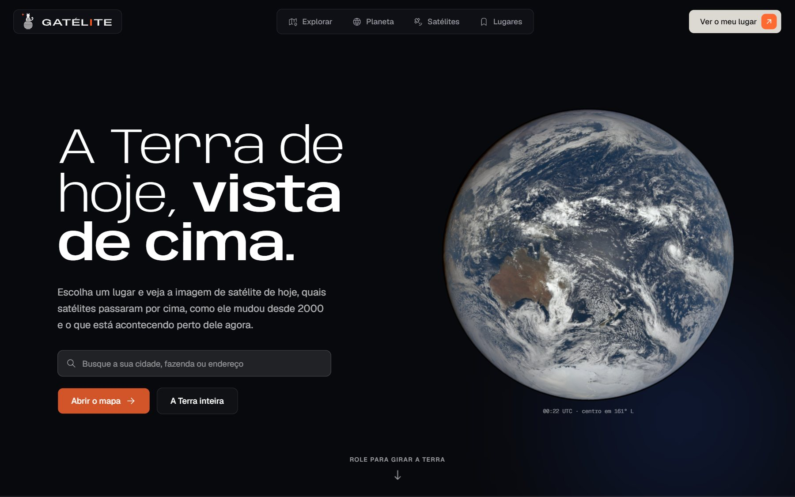
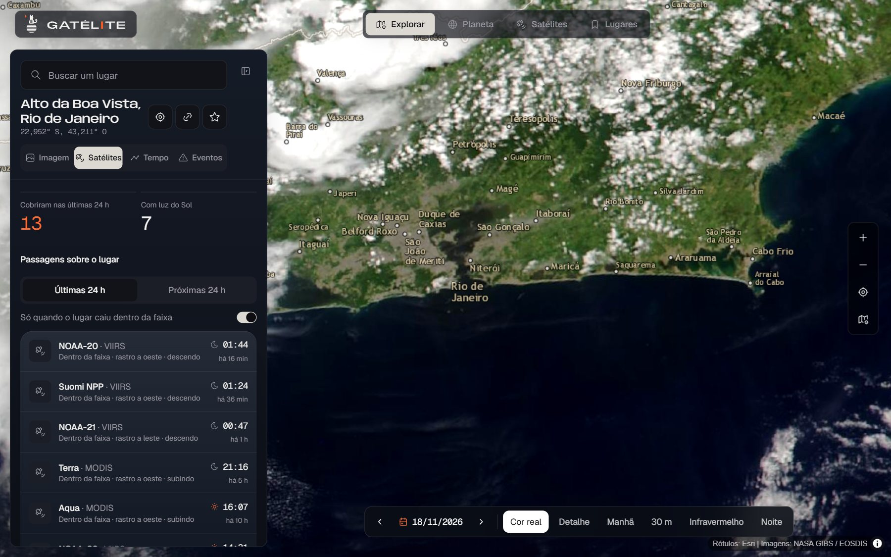
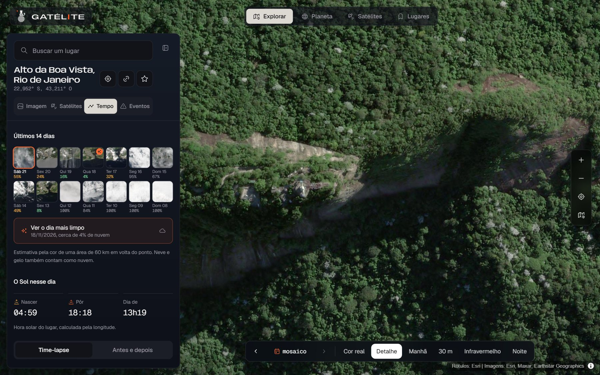
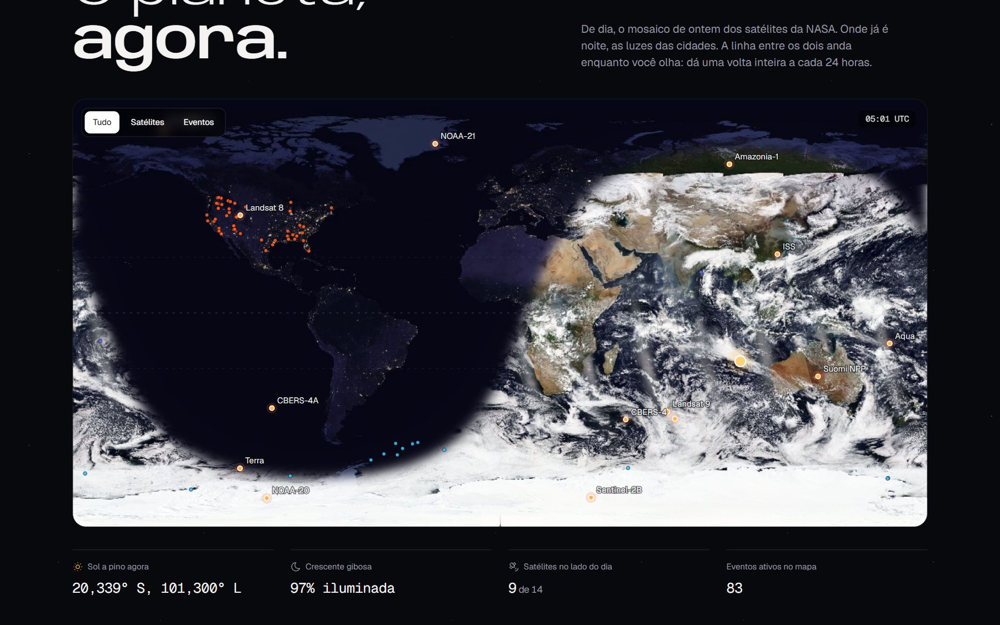
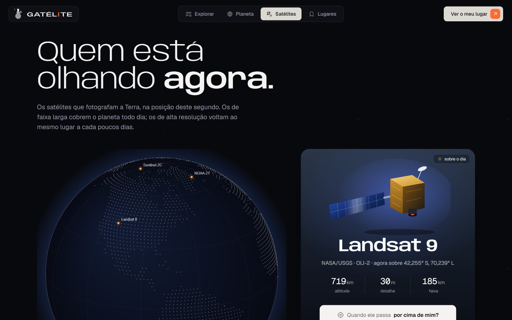
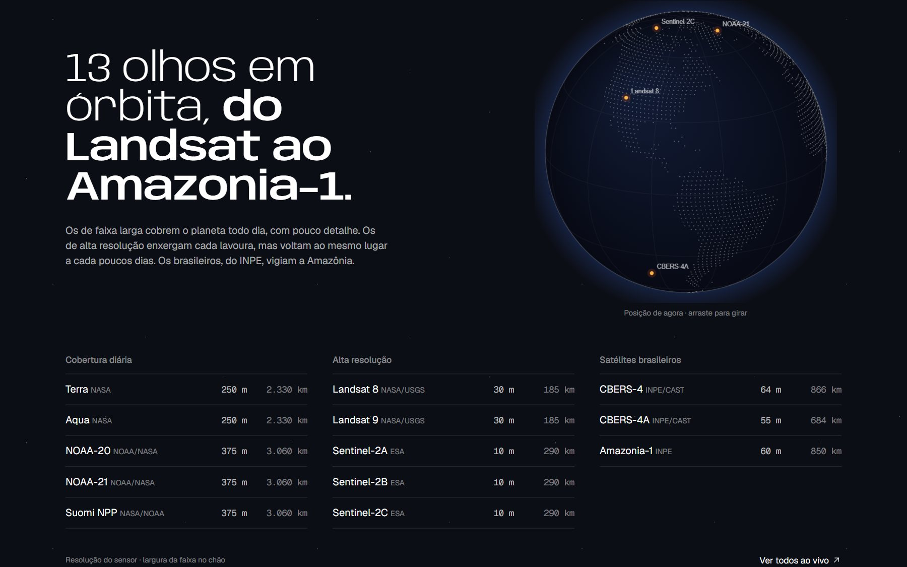
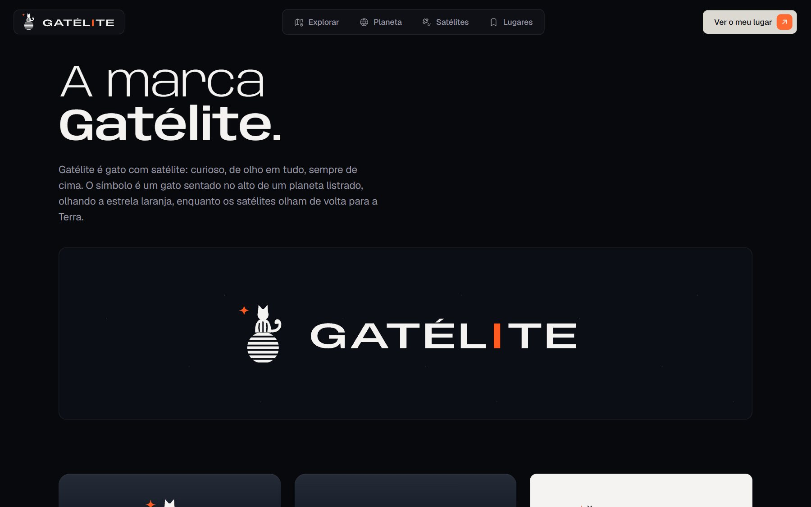
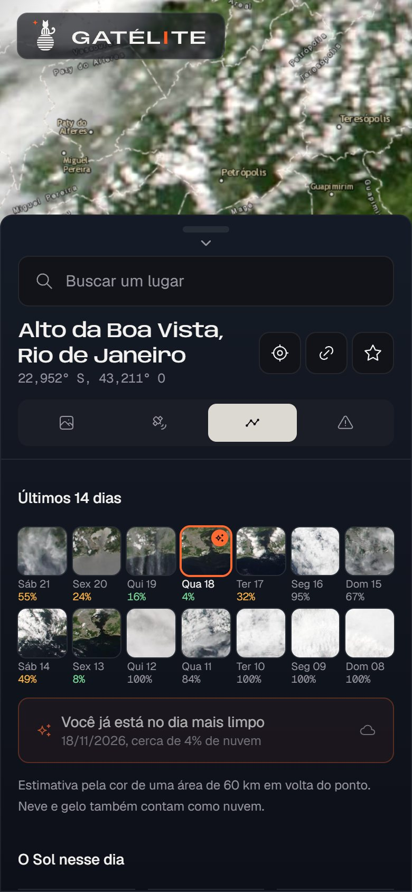

<p align="center">
  <picture>
    <source media="(prefers-color-scheme: dark)" srcset="public/brand/gatelite-logo-white.svg">
    
  </picture>
</p>

<p align="center"><strong>A Terra de hoje, vista de cima.</strong></p>

<p align="center">
  Escolha um lugar e veja a imagem de satélite do dia, quais satélites passaram por cima, como ele mudou desde 2000 e o que está acontecendo perto dele agora. Tudo com dados abertos da NASA, sem login e sem banco de dados.
</p>

<p align="center">
  
  
  
  
  
  
  
  
</p>

<p align="center">
  
</p>

## O que dá para fazer

**Ver o seu lugar de cima.** O explorador abre um globo com o mosaico diário dos satélites da NASA (VIIRS e MODIS), Landsat e Sentinel a 30 m, infravermelho, luzes da noite, temperatura e fumaça. Para chegar no nível da rua, a camada *Detalhe* usa um mosaico de alta resolução: dá para ver casas, quadras e o Cristo Redentor.

**Achar o dia sem nuvem.** A aba Tempo mostra os últimos 14 dias do lugar lado a lado e mede a nuvem de cada um pela cor da imagem. Um toque leva ao dia mais limpo. Junto vêm o nascer e o pôr do Sol e a duração do dia.

**Saber quem passou por cima.** As passagens das últimas e das próximas 24 horas são calculadas no navegador (SGP4, num Web Worker) para 14 satélites: se o lugar caiu dentro da faixa de imagem, de dia ou de noite, e o atalho para a foto daquele dia.

**Ver como mudou.** Time-lapse do mesmo dia do ano, de 2001 até hoje, e antes e depois com cortina arrastável.

**Acompanhar o planeta agora.** Um mapa-múndi com o lado do dia e o da noite andando em tempo real, as luzes das cidades, o ponto onde o Sol está a pino, a frota de satélites e os eventos naturais ativos (queimadas, tempestades, vulcões e icebergs).

<table>
  <tr>
    <td width="50%"></td>
    <td width="50%"></td>
  </tr>
  <tr>
    <td>Passagens sobre o lugar, com a faixa e o rastro de cada satélite no mapa.</td>
    <td>Camada detalhada e a tira dos últimos 14 dias com a nuvem estimada.</td>
  </tr>
  <tr>
    <td width="50%"></td>
    <td width="50%"></td>
  </tr>
  <tr>
    <td>O planeta agora: dia, noite, luzes, satélites e eventos.</td>
    <td>A frota ao vivo, com a posição de cada satélite a cada segundo.</td>
  </tr>
  <tr>
    <td width="50%"></td>
    <td width="50%"></td>
  </tr>
  <tr>
    <td>Os satélites acompanhados, por resolução e largura da faixa.</td>
    <td>A marca: o gato no planeta, cores, tipografia e adesivos.</td>
  </tr>
</table>

<p align="center">
  
  &nbsp;&nbsp;
  
</p>

## Páginas

| Rota | Conteúdo |
|---|---|
| `/` | A Terra girando com a rolagem (fotos EPIC do dia), quem passou sobre cidades brasileiras, frota ao vivo, antes e depois de Novo Progresso (PA) e eventos ativos |
| `/explorar` | Globo com as camadas por data, passagens, dias limpos, Sol, time-lapse e eventos. A visão inteira fica na URL |
| `/planeta` | O mapa do planeta agora, as fotos EPIC dia a dia, as estações lado a lado e a foto astronômica do dia |
| `/satelites` | Posição de cada satélite a cada segundo e a próxima cobertura sobre você |
| `/lugares` | Lugares salvos no aparelho, com a imagem mais recente de cada um |
| `/marca` | Logo, cores, tipografia, adesivos e SVGs para baixar |
| `/sobre` | Fontes, como as passagens são calculadas e privacidade |

## Stack

| Camada | Escolha |
|---|---|
| Framework | Next.js 16 (App Router, Turbopack, Cache Components com `use cache`) e React 19 |
| Interface | shadcn/ui sobre Base UI, Tailwind CSS 4, Tabler Icons, Motion |
| Tipografia | Anybody (display larga) e Geist |
| Mapa | MapLibre GL 6 em projeção de globo, com blocos raster do NASA GIBS |
| Órbitas | satellite.js (SGP4) a partir dos elementos OMM da CelesTrak, num Web Worker |
| Astronomia | astronomy-engine (Sol, Lua, terminador) e d3-geo |
| Estado | nuqs (a visão na URL), Zustand persistido (lugares salvos), TanStack Query |
| Qualidade | TypeScript estrito, Vitest no domínio, Biome |

Sem banco de dados: a URL guarda a visão, o aparelho guarda os lugares e o servidor só faz cache das APIs externas.

## Arquitetura

```
src/
  domain/      regras puras e testadas: satélites, órbitas e passagens, camadas, nuvens, Sol, eventos, EPIC
  server/      clientes das APIs externas com cache, timeout e reserva local
  app/         páginas, rotas /api e metadados (Open Graph, manifest, sitemap)
  components/  ui (shadcn), mapa, explorar, terra, planeta, satelites, site, brand
  lib/         consultas, estado dos lugares, imagens sociais, utilitários
  styles/      CSS do hero orbital e do rodapé
```

## Fontes de dados

| Fonte | Uso |
|---|---|
| NASA GIBS (WMTS e WMS) | Mosaicos diários VIIRS e MODIS, HLS 30 m, infravermelho, luzes da noite, temperatura, aerossóis, Blue Marble |
| NASA EPIC | Fotos do planeta inteiro tiradas a 1,5 milhão de km |
| NASA EONET v3 | Eventos naturais ativos |
| NASA APOD | Foto astronômica do dia |
| CelesTrak | Elementos orbitais dos satélites |
| Esri World Imagery | Mosaico de alta resolução e rótulos do mapa |
| Photon e Open-Meteo | Busca de lugares e nome do ponto tocado no mapa |
| Natural Earth | Continentes do globo pontilhado |

Projeto independente, sem ligação oficial com a NASA.

## Licença

[MIT](LICENSE), por [devrafcks](https://github.com/devrafcks).
